# TEKNOBUILT-AI-ML-ENGINEERING-ASSESSMENT

AI/ML engineering assessment with two tasks:

| Task | Where | Form |
|---|---|---|
| Task 1: field data digitization pipeline for safety observation forms | [`task_1_field_digitization/`](task_1_field_digitization/README.md) | working Python pipeline, tests, sample output |
| Task 2: P6 schedule batch classification | [this README, Task 2 section](#task-2-p6-schedule-batch-classification-architecture) | architecture and design (not implemented in code) |

## Repository layout

```
README.md                       this file (overview, Task 1 summary, Task 2 architecture)
task_1_field_digitization/
  README.md                     detailed Task 1 documentation
  requirements.txt              Python dependencies
  config/                       thresholds.yaml, form_semantics.yaml (names and options, no coordinates)
  src/field_digitization/       the pipeline (python -m field_digitization)
  tests/                        unit, synthetic and real-sample tests
  data/input/                   Sample_input.pdf        (git-ignored: real form data)
  data/template/                template.png            (git-ignored)
  data/ground_truth/            transcription fixture   (git-ignored)
  data/output/                  extracted_observations.json, processing_report.json
```

## Setup

Requires Python 3.11 (tested on 3.11.9). Run from the repository root:

```powershell
python -m venv .venv
.\.venv\Scripts\python.exe -m pip install -r task_1_field_digitization\requirements.txt
```

Dependencies are PyMuPDF, opencv-python-headless, numpy, pydantic, PyYAML, pytesseract and pytest.

Tesseract OCR is optional and installed separately (Windows: `winget install UB-Mannheim.TesseractOCR`). Without it,
tick boxes are still read, and every text field is reported as `ocr_unavailable` with a null value.

Tested environment: Windows, Python 3.11.9, OpenCV 5.1.0, PyMuPDF 1.28.2, Tesseract 5.4.0. No other versions were tested.

## Running Task 1

Place `Sample_input.pdf` in `task_1_field_digitization/data/input/` and the blank form `template.png` in
`task_1_field_digitization/data/template/`. Then:

```powershell
cd task_1_field_digitization
$env:PYTHONPATH = "src"
..\.venv\Scripts\python.exe -m field_digitization                  # writes data/output/*.json
..\.venv\Scripts\python.exe -m field_digitization --ocr none       # without OCR
..\.venv\Scripts\python.exe -m pytest -p no:cacheprovider          # test suite
```

Outputs:

- `data/output/extracted_observations.json`: one result per page, following the schema in `schema.py`.
- `data/output/processing_report.json`: counts by status.

Two runs on the same input produce byte-identical files. The exit code is 2 when the PDF or the template cannot be used.

## Task 1 summary: architecture and resilience

The full description is in [`task_1_field_digitization/README.md`](task_1_field_digitization/README.md).

**Per-page flow:**

1. Ingest the page and read its text layer.
2. Quality gate: classify the page as corrupted, blank or unreadable where applicable.
3. Look for a "FAILED TEST FORM" marker. The PDF text layer is checked first, with an OCR fallback.
4. Align the page to the template with SIFT and an affine RANSAC fit. The fit has to pass several
   gates and an independent ruled-line check.
5. Take the layout from the template itself, not from fixed coordinates.
6. Detect checklist rows from each page's own grid, read the tick boxes, and run OCR on the text fields.

**Resilience rules:**

- Each page is isolated. An error marks only that page `failed`; the other pages continue.
- Blank, unreadable, damaged and unalignable pages yield no form data.
- A choice group is `answered` only when exactly one box is checked and the others are clearly empty.
  Otherwise it is `unanswered`, `conflict` or `uncertain`, and it is flagged for review.
- Handwritten text is always a `needs_review` candidate, kept with its OCR confidence and engine.
  The schema rejects `extracted` for handwriting.

**Result on the supplied 4-page sample:**

- Pages 1–3: `needs_review`, with 8, 8 and 9 checklist rows; all 43 choice groups answered.
- Page 4: `failed_test_form`, found in the PDF text layer.
- Processing completed on 4/4 pages; review required on 3/4; fully automatic extraction on 0/4.
  The 0/4 is expected because every form contains handwriting.

**Agreement with a single-reader transcription.** That transcription has not been independently
verified, so these figures are not an accuracy measurement:

| Item | Agreement |
|---|---|
| Tick-box cells | 172/172 |
| Section titles | 3/3 |
| Checklist questions (printed) | 23/25 |
| CCZJV questions (printed) | 11/12 |
| Handwritten candidates | 10/18 |

Three printed questions were wrongly accepted as `extracted` at confidence ≥ 0.80:

- a dropped dash;
- "avalid" for "a valid";
- "Job" for "job".

**Main limitations:**

- Validated on one clean digital sample only. Real scans and pen handwriting are untested.
- Tesseract is unreliable on handwriting, and its confidence is not a usable review signal.
- Small errors in printed text can still pass as `extracted`.
- Checklist rows must sit in the template's slots.
- The pipeline is not production-validated.

---

## Task 2: P6 schedule batch classification (architecture)

**Status: design only.** No Task 2 code exists in this repository. No accuracy, latency, throughput or
cost figure below is measured. The only measured numbers are counts taken directly from the supplied CSV,
marked **[CSV]**. Anything else is labelled as an assumption or an illustration.

### Input: what the supplied CSV actually contains

The assessment supplies `P6_Schedule_Sample.csv`. **The design uses only its two columns.** It does not
assume a WBS path, a discipline field, activity codes or any other metadata.

| Fact **[CSV]** | Value |
|---|---|
| Columns | `Activity ID`, `Activity Name` (UTF-8 with BOM) |
| Rows | 4,499; every row has both values; every Activity ID is unique |
| Unique Activity Names | 741 exact; **739 case-insensitive**; 734 after also collapsing repeated spaces |
| Name frequency | 504 names occur once; 120 names occur 10 or more times; the 100 most frequent names cover 3,268 rows |
| Single-word names | 30 names covering 827 rows, for example `Testing` (137 rows), `Dressing` (128), `Labeling` (128), `Cabling`, `Splice`, `Patching`, `Terminations` |
| Activity ID first token | 8 values: `ELE` (998 rows), `ARC` (915), `TELE` (910), `CON` (810), `MEC` (500), `SEC` (300), `GEN` (46), `ME` (20) |
| Activity ID shape | mostly `PREFIX-C1-c1-6730` style; 27 different second tokens (`C1`–`C5`, `AD`, `ZF`, `L1`, …) whose meaning is not documented |
| Names under more than one first token | 4, for example `Testing` (`TELE` 128, `CON` 9) and `Install HL VESDA Pipework` (`ELE` 40, `GEN` 20) |
| Names listing several systems | 5 names containing `FA /SEC/GPL/BAS` (300 rows), for example `Containment - Secondary FA /SEC/GPL/BAS` (80 rows, all `ELE`); also `Installation of Containment for FA,GS,BMS, BAS - Drops` and `Secondary Containment (FA, GS, BAS)` |
| Spelling and spacing variants | `Containmnet`, `Pipwork`, `Condenstate`, `secuirty`; `Fit out  UMS 01` (double space); `MEP Testing` / `MEP testing` |

Observations that shape the design. These are interpretations, not facts:

- **The CSV has no discipline column.** The only client-side hint of a discipline is the first token of
  the Activity ID. The assessment states that client discipline assignments are often wrong, so this
  token is treated as unverified.
- **The first tokens do not map one-to-one onto the 12 taxonomy disciplines.** There is no Fire Alarm,
  BAS, Fire Protection, Plumbing, Structural or Landscape token. `GEN`, `ME` and `CON` have no obvious
  counterpart (`CON` holds names such as `Storm Water`, `Foul Water`, `LV`, `MV`).
- **Some names suggest a discipline that differs from their prefix.**
  - Sprinkler pipework appears under `MEC` and `ME`, while the taxonomy has a Fire Protection discipline.
  - `MV Cable Pulling` appears under `GEN`.
  - `Install AC Units System` appears under both `ELE` and `ARC`.
  Which label is correct is for the reviewed process to decide. The design must not assume the prefix is right.
- **Adjacent rows in the file give context.**
  - The `CON` `Testing` row sits between `Surcharge Install` and `Waiting Time for Anchors`.
  - A `TELE` `Dressing` row sits between rack installation and `Cable pulls`.
  This is useful evidence, but the file order is not guaranteed to be meaningful.
- **Unknown abbreviations exist.** `GPL` and `GS` are not taxonomy disciplines, and their meaning is not documented.

### Goal and taxonomy

Classify every activity row (4,499 in the sample; the design targets 50,000+). Each Activity ID gets
exactly one of the following:

- one **(discipline, sub-discipline) pair** from the supplied taxonomy; or
- the status `unclassified`, with a reason, and a place in the review queue.

No other output is allowed, and every Activity ID keeps its own output record.

| Discipline | Sub-disciplines |
|---|---|
| Architectural | Acoustical Ceiling Tile; Exterior Finishes; Hot Aisle Containment; Interior Finishes; Miscellaneous |
| Building Automation System | Pull, Test and Terminate |
| Civil | Exterior Equipment Pad; Foundation Works; Miscellaneous; Slab on Grade; Underground Dry Utilities; Underground Wet Utilities |
| Electrical | Cable Pulling; Cable Termination; Cable Trays Drops; Cable Trays Main; Miscellaneous; Rough-In |
| Fire Alarm | Pull, Test and Terminate |
| Fire Protection | Installation |
| Landscape | Miscellaneous |
| Mechanical | Exterior Installation; Rough-In |
| Plumbing | Rough-In |
| Security | Pull, Test and Terminate |
| Structural | Envelope; Exterior Equipment Steel; Miscellaneous |
| Telecommunications | Basket Tray Main; Digital Antenna System / Radio Over IP; Miscellaneous; Production Fiber |

The taxonomy has 12 disciplines and 32 valid pairs.

Several sub-discipline names repeat across disciplines:

- "Miscellaneous" appears in 6 disciplines.
- "Pull, Test and Terminate" appears in 3.
- "Rough-In" appears in 3.

The sub-discipline alone is therefore ambiguous. **The unit of classification is the pair**, and a pair
such as *Plumbing / Installation* is invalid even though both names exist in the taxonomy.

The word "containment" is also ambiguous. The taxonomy has *Architectural / Hot Aisle Containment*,
while names such as `Containment - Primary LV Mains` describe cable containment (trays). The word alone
never decides the class.

### Where each requirement is addressed

| Requirement | Approach | Section |
|---|---|---|
| Analyse the Activity Name; the two CSV columns are the input | the name is the primary evidence; the Activity ID is kept for every record and parsed only for weak hints | Input, 1, 3 |
| Supplied taxonomy only | versioned registry of the 32 pairs; every result is a registry ID or `unclassified` | Goal and taxonomy, 2 |
| Scalable batch processing | streaming ingestion, deduplication, fixed-size batches, process pool, bounded LLM concurrency, checkpointed resumable jobs | 1 |
| Strict constraint enforcement | enum-constrained structured output, a validator that rejects any other label, no auto-created categories | 2 |
| Client labels may be wrong | classification is computed from the name; the prefix is compared afterwards and conflicts are reported, never copied | 3, "Evidence and difficult cases" |
| Context-free names, multi-discipline names | sufficiency and multi-discipline checks route these to `unclassified` or review instead of forcing a label | "Evidence and difficult cases" |
| Cost and latency reduction | deduplication (739 case-insensitive names for 4,499 rows **[CSV]**), cache, local stages first, LLM only for the low-confidence remainder in multi-row batches | 4, 5, "Cost reduction" |
| Accuracy | name-first evidence, cross-stage agreement checks, confidence thresholds, evaluation on a labeled validation set | 3, 4, "Accuracy" |
| Confidence thresholds, caching, human review | per-stage thresholds tuned to a target precision; versioned cache; prioritized review queue that feeds back into rules and examples | 4 |

### Evidence and difficult cases

Every decision uses three kinds of evidence, in strict order of authority:

1. **Activity Name (primary).** Only name evidence can propose a discipline and sub-discipline.
2. **Activity ID prefix (weak).** For example `ELE`, `TELE`, `ARC`, `CON`. It can rank or confirm
   candidates that the name already supports. It can never add a candidate the name does not support,
   never override contradictory name evidence, and never decide a row on its own.
3. **Neighbouring activities (weak).** The names of rows adjacent in the same ID group and number
   sequence (or, failing that, in file order). The same limits apply as for the prefix.

**How weak evidence earns any weight.**

- A prefix or neighbour signal is used only after its reliability has been measured on **reviewed**
  examples: how often reviewers' labels agree with what the signal suggests, per prefix value.
- Until enough reviewed rows exist for a prefix, its weight is zero.
- A prefix found unreliable keeps weight zero, and its disagreements are reported instead.
- The mapping from a prefix to candidate disciplines (for example `TELE` to Telecommunications) is
  itself learned from reviewed data and versioned. It is not hard-coded, because the CSV shows that
  prefixes do not correspond one-to-one with disciplines.

**1. Context-free names** (for example `Testing`, `Dressing`, `Labeling`).

- *Detection.* A name is marked `context_dependent` when any of these holds:
  - it matches a curated list of generic work verbs and nouns (testing, dressing, labeling, cabling,
    splice, patching, terminations, commissioning);
  - the name-level candidates span more than one discipline with no clear margin;
  - the same normalized name occurs under different prefixes with reviewed labels in different
    disciplines.
  `Testing` is an example of the third case: it occurs under `TELE` and `CON` **[CSV]**.
- *Decision.* The name is classified per **context group** rather than once: name plus prefix plus a
  short summary of the neighbouring names.
  - A context group is auto-accepted only when the weak evidence is unanimous, every signal involved
    has validated reliability, and the combined confidence clears the auto-accept threshold.
  - Otherwise the rows get `unclassified` with the reason `insufficient_context`, and the group goes to
    review with its neighbours shown.
- *Sub-discipline as well.* Even a resolved discipline may not fix the sub-discipline. Telecommunications
  has no "Pull, Test and Terminate" pair, so `Testing` in a telecom context still needs a reviewer to
  choose among its four pairs. The pipeline does not guess "Miscellaneous" to fill the gap.
- *Review efficiency.* The review queue holds one item per context group, not per row. For example,
  `Testing` under `TELE` is 128 rows **[CSV]**, which a single decision can settle.

**2. Activity ID prefixes as weak evidence.**

- The ID is parsed into tokens (first token, second token, sequence number). The tokens are stored with
  the row but are **not** part of the name used for deduplication.
- Prefix evidence is applied only *after* name evidence has produced candidates.
  - When the name supports several candidates and the prefix's validated mapping favours one of them,
    the prefix can raise that candidate's confidence.
  - When the name confidently supports a discipline the prefix does not suggest, the name wins. The
    record is flagged `prefix_conflict`; the confidence threshold is still applied normally.
  - A prefix alone, with no name support, never produces a classification.
- `GEN`, `ME` and any new prefix start with zero weight. The 27 undocumented second tokens are kept
  for audit but get no weight until their meaning is confirmed.

**3. Multi-discipline names** (for example `Containment - Secondary FA /SEC/GPL/BAS`).

- *Detection.* A reviewed abbreviation glossary, plus rules that split lists separated by `/`, `,` and
  brackets, finds several discipline or system mentions in one name.
  - Examples from the CSV: `FA`, `SEC`, `BAS`, `BMS`.
  - Unknown tokens such as `GPL` and `GS` are recorded as `unknown_system_token`. They are never mapped
    to a discipline by guesswork.
  - The record lists every signal found in `discipline_signals`.
- *Classify the work, not the systems served.* An activity that installs one shared item serving
  several systems is still one piece of work.
  - If the domain owner has approved a policy for that work type (for example, which pair shared
    low-voltage containment belongs to), a versioned rule applies the policy deterministically.
  - Without an approved policy, the row is `unclassified` with the reason `multi_discipline`.
- *Genuinely separable activities.* Some names describe separate work per system, for example
  `Cabling - Secondary - FA /SEC/GPL/BAS` could mean separate cable pulls per system.
  - The classifier never creates new Activity IDs or splits rows itself, because that would change the
    client's schedule.
  - It marks the record `separable_candidate` and lists the per-system pairs that the name evidence
    supports, all from the registry.
  - The row stays `unclassified` until a reviewer chooses one pair or recommends that the planner split
    the activity in the schedule.
- *Ambiguous wording.* "Containment" with FA/SEC/BAS could be cable trays (Electrical) or a basket tray
  (Telecommunications), and it is not Hot Aisle Containment. Such cases go to review rather than being
  forced into one class.

**4. Client misclassification.**

- The pipeline classifies every Activity Name independently, from name evidence first. The client's
  apparent label (the prefix) is compared only afterwards and never copied into the output.
- Each record carries `prefix_family` and `prefix_agrees` (`yes`, `no`, `unknown`). The run report lists
  every conflict between the classification and the prefix, which is useful feedback for the client.
- Reviewers see the prefix but are asked to judge the activity on its name. Their decisions measure how
  reliable each prefix is, and that reliability is what limits the prefix's weight.

**5. Deduplication with one output record per Activity ID.**

- `name_key = hash(normalized name)`. Normalization upper-cases the name, collapses whitespace, and
  corrects known spelling variants from a reviewed list (for example `Containmnet` to `Containment`).
  In the sample this reduces 4,499 rows to 739 case-insensitive names, or 734 after collapsing spaces
  **[CSV]**.
- Most names are classified once per `name_key`. Context-dependent names are classified once per
  context group, `(name_key, prefix_family, neighbour_summary_key)`.
- Results are stored per key, then **joined back to every row by Activity ID**. The output has one
  record for each of the 4,499 Activity IDs, each with:
  - its own `activity_id` and `prefix_family`;
  - the `category_id` or `unclassified`;
  - `decision_key`, recording which shared decision the result came from;
  - `method`, `confidence`, `reason` and the version fields.
- A reviewer can override a single Activity ID. The override is stored per row and takes precedence
  over the shared decision for that row only.

### Cost reduction

The work sent to a paid model shrinks at each step:

1. **Deduplication and context grouping.** In the sample, at most 739 name-level decisions (plus a
   small number of extra context groups for context-dependent names) are needed for 4,499 rows
   **[CSV]**. Whether real 50,000-row schedules repeat as much is unknown until measured.
2. **Cache.** Accepted results are reused across files and runs until the taxonomy, glossary or rules change.
3. **Local stages first.** Rules, the glossary, exact and fuzzy matching, and embeddings or a lightweight
   classifier run on local hardware, with no per-call charge.
4. **LLM only for the remainder.** Rows are sent in multi-row requests with a short candidate list
   instead of all 32 definitions, which keeps prompts small. A provider batch API is used when results
   are not urgent.
5. **Review effort.** The queue is ordered by rows affected, so one decision on a frequent name or context
   group settles many rows.
6. **Feedback.** Reviewer decisions become rules, glossary entries and examples, so fewer rows should
   reach the LLM in later runs. This must be confirmed by monitoring the per-stage counts.

No cost saving has been measured.

### Accuracy

- Candidates come from the Activity Name. The prefix and the neighbours only rank or confirm them, and
  only within their validated reliability (see "Evidence and difficult cases").
- When the discipline is resolved, the sub-discipline is chosen only within that discipline. This
  targets the main confusion risk: sub-discipline names repeated across disciplines.
- A row is auto-accepted only above a threshold chosen on the validation set for a target precision.
  When stages disagree, the row goes to review instead of letting one stage win.
- Insufficient context and multi-discipline names produce `unclassified`, never a forced label.
- Accuracy is measured, not assumed. Per-pair precision, recall and F1, the confusion matrix, and
  precision among auto-accepted rows are computed on a held-out labeled set before every release
  (section 4). **No accuracy figure exists yet.**

### Overview

```mermaid
flowchart LR
  A[CSV: Activity ID, Activity Name] --> B[Streaming ingestion<br/>and schema validation]
  B --> C[Normalize name -> name_key<br/>parse ID tokens, find neighbours]
  C --> D[Deduplicate by name_key<br/>or context group]
  D --> E{Cache hit?}
  E -- yes --> J
  E -- no --> S[Sufficiency and<br/>multi-discipline checks]
  S -- insufficient or multi-discipline --> Q
  S -- ok --> F[Stage 1: rules, glossary,<br/>exact and fuzzy match on the name]
  F -- confident --> W
  F -- not confident --> G[Stage 2: embeddings /<br/>lightweight classifier]
  G -- confident --> W
  G -- low confidence --> H[Stage 3: LLM on batches,<br/>constrained output]
  H --> W[Weak-evidence check:<br/>prefix and neighbours]
  W --> V[Taxonomy validator]
  V -- valid and above threshold --> J[Join back to every Activity ID]
  V -- invalid, low or conflicting --> Q[Human review queue]
  Q --> J
  Q -. labels .-> L[(Reviewed labels, rules,<br/>glossary, prefix reliability)]
  L -.-> F & G & W
```



### 1. Ingestion, normalization, batching and resumability

**Ingestion.**
- Read the CSV as a stream, in chunks, so the whole file is never held in memory. The parser handles
  the UTF-8 BOM.
- Validate each row:
  - exactly the two columns `Activity ID` and `Activity Name`;
  - both values non-empty;
  - Activity ID unique within the file.
- Rows that fail validation go to a rejects file with the reason (`rejected_input`). They are never
  dropped silently.
- No other column is required. If a future export carries extra columns, they are ignored until a
  reviewed decision says how to use them.

**Normalization.**
- The name is upper-cased and whitespace is collapsed.
- Known spelling variants are corrected from a reviewed list.
- Abbreviations are expanded only from a reviewed, versioned glossary (for example `FA`, `SEC`, `BAS`).
  An unknown abbreviation stays as written and is flagged.
- The original name is always kept for audit.
- The Activity ID is parsed into tokens and stored separately. It never enters `name_key`.

**Batching and parallelism.**
- Unique keys are grouped into fixed-size batches. The size is configurable, for example 500 keys for
  the local stages and 20–50 keys per LLM request.
- A job manifest records each batch with an input checksum.
- The local stages are CPU-bound and run in a process pool.
- LLM calls are I/O-bound. They run with bounded concurrency (a semaphore sized to the provider's rate
  limit), or through a provider batch API when latency does not matter.
- 50,000 rows fit on one machine. The same manifest and worker model scales out to a queue (for example
  Celery or RQ) if volume grows.

**Retries.**
- Transient errors (timeouts, HTTP 429 and 5xx) are retried with exponential backoff and jitter, up to N attempts.
- An LLM response that fails schema validation is retried once, with the validation error included in the prompt.
- A batch that still fails goes to a dead-letter list. Its rows become `unclassified` with the reason
  `processing_failed` and enter the review queue. The job continues.

**Checkpoints and resumability.**
- Batch states (`pending`, `running`, `done`, `failed`) and results are stored transactionally, for
  example in SQLite or Postgres.
- A batch's results and its `done` status are committed together.
- On restart the job skips `done` batches and re-runs only `pending`, `running` (stale) or `failed` batches.
- Results are keyed by `decision_key + taxonomy_version + pipeline_version`, so re-running a batch is idempotent.

### 2. Strict taxonomy enforcement

**Canonical taxonomy registry.** A single versioned file (YAML or JSON) is loaded once and is the
only source of valid labels. For each pair it records:

- a stable ID such as `ELEC.CABLE_PULLING` or `CIVIL.MISC`;
- the discipline and sub-discipline display names;
- a short definition;
- inclusion keywords and exclusion keywords;
- curated example activity names.

Every component reads labels from this registry. No label is ever typed in code or prompts by hand.
Glossary entries such as `FA` or `BAS` are evidence, not categories.

**Constrained structured outputs.**
- Every stage, including the LLM, must return either a pair ID from the registry, or `null` with a
  reason from a fixed list: `insufficient_context`, `multi_discipline`, `out_of_scope`.
- For the LLM, the response schema declares `category_id` as an enum of the 32 IDs (or of the
  shortlisted candidates) plus `null`, with temperature 0 and the provider's structured-output or
  tool-calling mode.
- The prompt states the definitions and gives the Activity Name as the main evidence. The prefix and
  neighbouring names are clearly marked as unverified context. The prompt also states that
  "Miscellaneous" means "belongs to this discipline but no other sub-discipline fits", not "unknown".

**Validation and rejection.**
- A validator, for example a Pydantic model built from the registry, checks every result before it is stored:
  - the ID exists, or the result is `unclassified` with a reason from the fixed list;
  - the discipline and sub-discipline form a registered pair;
  - the confidence lies in 0..1;
  - the method and versions are recorded.
- Anything else is rejected. Free-text labels, near-miss spellings and new categories are never mapped
  or auto-created.
- A rejected LLM answer is retried once. A second rejection sends the row to review.
- Rejection counts are monitored.

**Out-of-scope rows.** Some names may belong to no discipline in the taxonomy, for example site set-up
or waiting times (`Initial Site Set Up …`, `Waiting Time for Anchors` **[CSV]**). These get
`unclassified` with the reason `out_of_scope`. They are not forced into a "Miscellaneous" pair. Whether
such rows should be classified at all is a question for the data owner.

### 3. Hybrid classification pipeline

The stages are ordered by cost. Each later stage sees only the keys the earlier stages could not settle.
The prefix and neighbour checks of "Evidence and difficult cases" apply to the output of every stage.

| Stage | Method | Accepts a key when |
|---|---|---|
| 0. Cache | lookup by `decision_key + taxonomy_version` | a prior accepted or reviewed result exists |
| 0b. Sufficiency and multi-discipline checks | generic-term list, glossary detection of several systems, cross-prefix label disagreement | never accepts; routes to stage 1, or to `unclassified` and review |
| 1. Deterministic | curated keyword and regex rules on the name, with priorities and exclusions; approved policy rules for known multi-system work types; exact match against reviewed names; fuzzy match (for example RapidFuzz token-set ratio) against reviewed examples | a single rule fires with no conflicting rule, or the fuzzy score clears a tuned threshold with a clear margin over the runner-up |
| 2. Statistical | local sentence embeddings with k-nearest-neighbour search over reviewed examples and pair definitions; and/or a lightweight classifier (TF-IDF character n-grams with logistic regression, a lexical baseline rather than a semantic model) with calibrated probabilities | the top-1 probability and the top-1/top-2 margin clear tuned thresholds |
| 3. LLM | batches of low-confidence keys, each with the name, the stage-2 top-k candidate pairs and their definitions, and the prefix and neighbour names marked as unverified; output constrained to registry IDs or `null` with a reason | the answer is valid, its confidence clears the threshold, and it does not contradict confident name evidence from stages 1–2 |
| 4. Human review | reviewer UI or spreadsheet showing the name, the prefix, the neighbours, the candidates and the evidence | always (final) |

Design notes:

- **Name first, then discipline, then sub-discipline.** Name evidence produces the candidates, and weak
  evidence can only rank them. When the discipline is settled, later stages choose only among that
  discipline's sub-disciplines. This prevents confusing the three "Pull, Test and Terminate" disciplines.
- **Disagreement is a signal.** If two stages disagree with high confidence, or the name and a reliable
  prefix disagree, the key goes to review. Neither side is allowed to win silently.
- **Feedback.** Reviewer decisions are added to the labeled set, the example index and the prefix
  reliability table, and can be promoted to rules or glossary entries. The local stages should therefore
  cover more rows over time. This is an expectation to verify through monitoring, not a guarantee.

### 4. Deduplication, caching, confidence, review and evaluation

- **Deduplication.** One decision per `name_key`, or per context group for context-dependent names;
  results are joined back to every Activity ID ("Evidence and difficult cases", item 5).
- **Caching.**
  - Accepted results are cached by `decision_key + taxonomy_version + rules/glossary/model version`.
  - A taxonomy, glossary or rule change invalidates the affected entries.
  - Human-reviewed results take precedence over automatic ones for the same key.
  - Per-row overrides take precedence over both.
- **Confidence thresholds.**
  - Each stage has its own thresholds, tuned on the validation set to reach a target precision for
    automatic acceptance. The target is a business decision, for example "at most 2% wrong among
    auto-accepted rows".
  - Keys below the threshold go to the next stage or to review.
  - Raw LLM self-reported confidence is not treated as calibrated. LLM answers are accepted only above
    a threshold set from validation results, and only after the consistency checks.
- **Human review.**
  - The queue is prioritized by rows affected.
  - Reviewers see the activity, its prefix, its neighbours and the top candidates.
  - Every decision is stored with reviewer, time and reason.
- **Output per Activity ID.** One record for every input row, with these fields:
  - `activity_id`, `activity_name` (original), `prefix_family`;
  - `discipline`, `sub_discipline`, `category_id` (null when unclassified);
  - `status` (`auto_accepted`, `needs_review`, `reviewed`, `unclassified`, `rejected_input`);
  - `reason` (for example `insufficient_context`, `multi_discipline`, `out_of_scope`, `low_confidence`,
    `processing_failed`);
  - `confidence` and `method` (`cache`, `rule`, `fuzzy`, `embedding`, `classifier`, `llm`, `human`);
  - `decision_key`;
  - `discipline_signals`, `prefix_agrees`, `prefix_conflict`;
  - `taxonomy_version` and `pipeline_version`.
- **Evaluation.**
  - Build a labeled validation set covering all 32 pairs, labeled by domain reviewers from the
    Activity Name and its context, with a second reviewer on a sample to measure label agreement.
  - Split by normalized name, so that the same name never sits in both training and validation. When
    more schedules are available, split by schedule file as well.
  - Report:
    - per-pair precision, recall and F1, plus macro-F1;
    - the confusion matrix, with attention to Miscellaneous versus the specific sub-disciplines and to
      the three "Pull, Test and Terminate" disciplines;
    - coverage and precision per stage;
    - precision among auto-accepted rows;
    - the rate of `unclassified` rows by reason;
    - the agreement rate between the classification and each prefix;
    - the reviewer override rate in production.
  - Re-run the evaluation on every rule, glossary, model, prompt or taxonomy change before release.

### 5. Cost, latency, throughput, monitoring, failure handling and trade-offs

**Cost model (formula, no measured figures).**
LLM cost ≈ (keys reaching stage 3 ÷ keys per request) × (prompt tokens + output tokens per request) ×
provider price per token.

Only keys left after deduplication, cache, the sufficiency checks, rules and the statistical stage
reach the LLM. In the sample the number of keys is bounded by 739 case-insensitive names plus a few
context groups **[CSV]**. The share of those keys that reaches the LLM is unknown.

*Illustration with assumed values only:* if 20% of 739 keys reached the LLM in requests of 25, that
would be about 6 requests for the 4,499-row sample. The real share has to be measured.

Stages 1–2 run locally, with no per-call cost.

**Latency and throughput.**
- Rules, glossary and fuzzy matching are cheap per key.
- Embedding cost depends on model size and hardware; a small sentence-embedding model on CPU is the
  assumed baseline.
- LLM throughput is bounded by the provider's rate limits and the configured concurrency.
- For an overnight batch job, a provider batch API trades latency for lower cost and rate-limit headroom.
- Expected end-to-end time for 50,000 rows has to be measured; no figure is claimed here.

**Monitoring.**
- Keys and rows per stage and status, plus cache hit rate.
- `unclassified` counts by reason.
- Prefix conflict rate per prefix.
- Invalid-category rejections.
- LLM error, retry and dead-letter counts.
- Tokens and cost per run.
- Batch latency percentiles.
- Review queue size, age and override rate.
- Distribution drift of predicted categories against previous runs.
- Alerts on sudden changes in any of these.

**Failure handling.**
- If the LLM is unavailable, the job still completes. Stage 1–2 results are stored, and the remaining
  rows are marked `needs_review` with the reason `llm_unavailable`.
- A circuit breaker stops calls after repeated failures.
- An input file that changes between runs is detected by its checksum and starts a new job.
- No stage can write a label that the validator has not accepted.

**Trade-offs.**

| Decision | Benefit | Cost |
|---|---|---|
| Activity Name as the only primary evidence | does not inherit client mislabels; works with the two supplied columns | context-free names cannot be settled automatically |
| ID prefix and neighbours as weak, validated evidence | resolves some ambiguous names cheaply; conflicts expose client mislabels | needs reviewed data before it carries any weight; file order may not be meaningful |
| Context groups for context-dependent names | different meanings of one name are not merged | more keys than pure name deduplication |
| `unclassified` for insufficient context and multi-discipline names | no forced or invented labels | review effort, until policies and feedback raise coverage |
| Rules and lookups first | cheap, deterministic, explainable | rules and the glossary must be curated; misspellings must be listed |
| Embeddings or a lightweight classifier in the middle | local, fast, no per-call cost, handles paraphrases | needs labeled examples; probabilities need calibration |
| LLM only for low-confidence batches | handles the long tail with little labeled data | per-call cost, rate limits, provider dependency, nondeterminism even at temperature 0 |
| Pair IDs with enum-constrained output | invalid categories are impossible to store | a taxonomy change needs a registry version bump and re-evaluation |
| Deduplication and cache | 4,499 rows reduce to 739 names in the sample **[CSV]** | cache invalidation must follow taxonomy, glossary and rule versions |

**Assumptions to confirm with the data owner:**

- the meaning of the Activity ID tokens (first and second tokens, sequence numbers) and whether ID or
  file order reflects work sequence;
- the meaning of `GPL`, `GS` and other abbreviations;
- policies for shared multi-system work (for example containment serving FA/SEC/BAS);
- whether out-of-scope activities should appear in the output as `unclassified`;
- the target precision for automatic acceptance;
- which LLM providers are allowed and whether schedule data may leave the organization;
- the availability of labeled historical schedules.

---

## Limitations of this submission

- Task 1 is validated on one supplied 4-page sample. It is not production-validated, and the agreement
  figures come from a transcription that has not been independently verified.
- Task 2 is an architecture document only. It contains no implementation and no measured performance.
